# Schermen

Dit zijn de ontwerpen van alle schermen, in de stijl Modern. Het zijn ontwerpen en geen foto's van het apparaat. De maten en kleuren staan in [de stijlgids](../stijlgids.md).

## Hoofdschermen

Je swipet naar links en rechts tussen radar, klok en weer. De bolletjes onderaan laten zien waar je bent.

<table>
<tr>
<td align="center">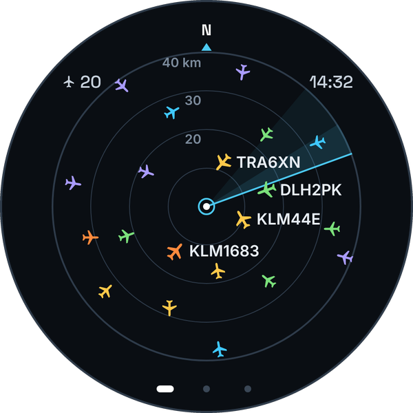 Radar</td>
<td align="center">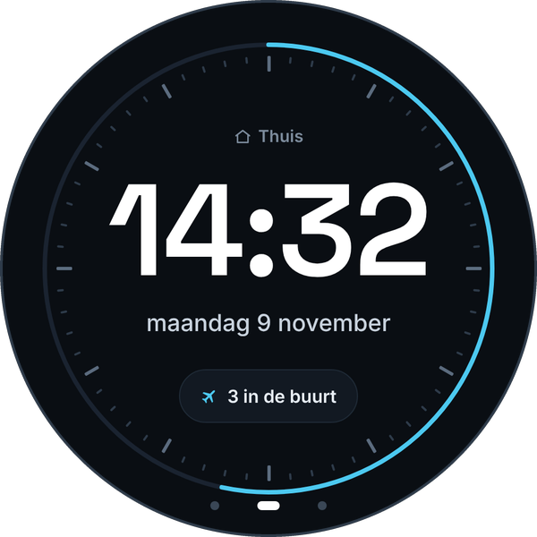 Klok</td>
<td align="center">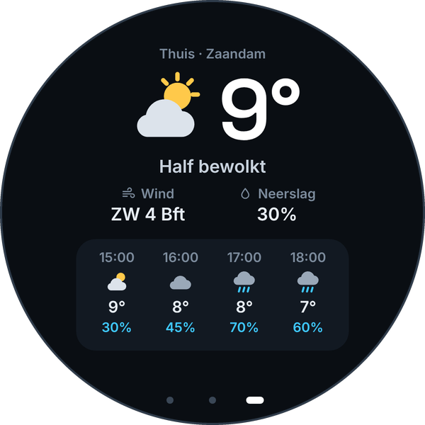 Weer</td>
</tr>
</table>

De kleur van een vliegtuig geeft de hoogte aan: oranje is laag (onder 1 km), daarna geel, groen en blauw, en paars is hoog (boven 9 km).

<table>
<tr>
<td align="center">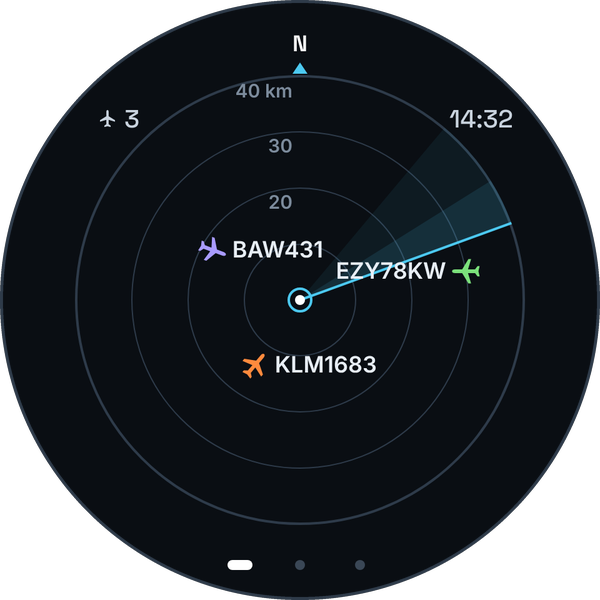 Rustig: 3 vliegtuigen</td>
<td align="center"> Druk: 20 vliegtuigen</td>
<td align="center">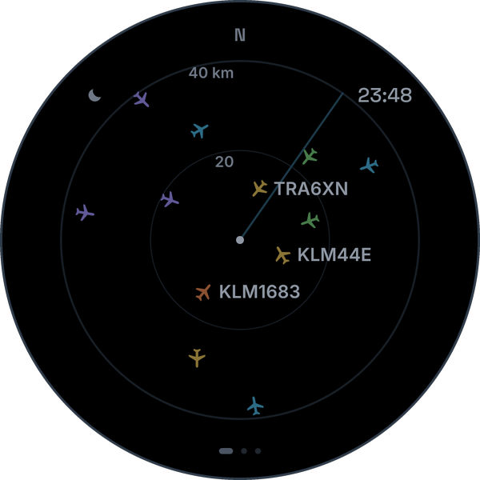 Nachtmodus</td>
</tr>
</table>

## Meer op het scherm

<table>
<tr>
<td align="center">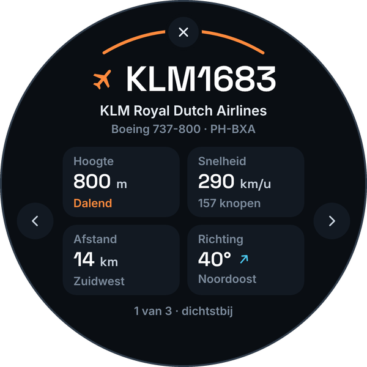 Tik op een vliegtuig: detailkaart</td>
<td align="center">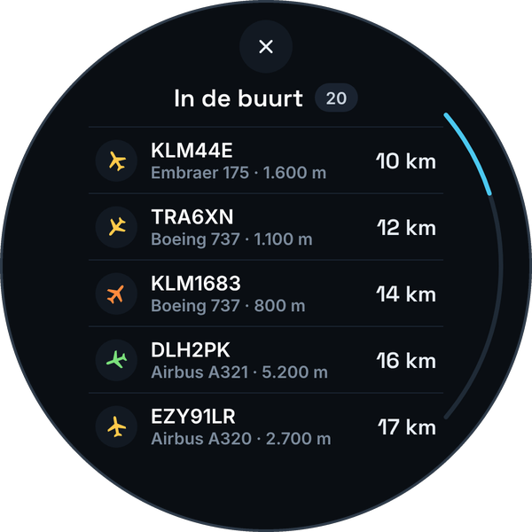 Swipe omhoog: lijst op afstand</td>
<td align="center">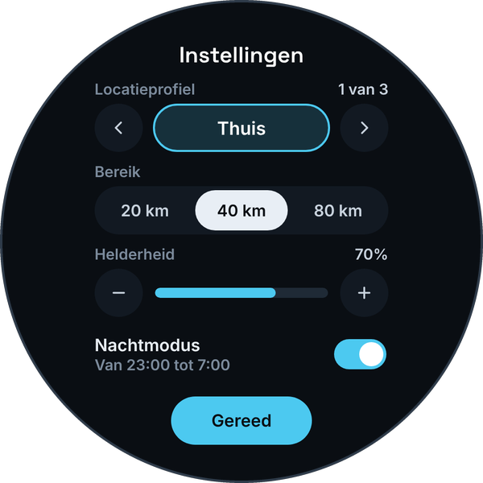 Swipe omlaag: instellingen</td>
</tr>
</table>

## Statussen

<table>
<tr>
<td align="center">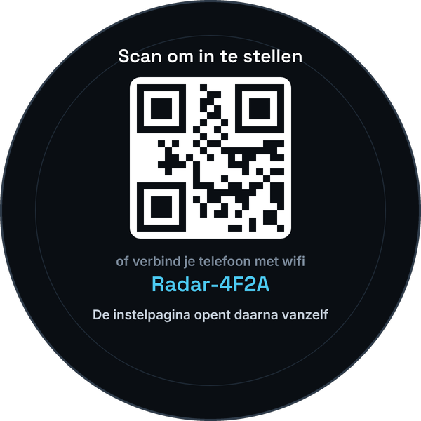 Eerste keer instellen</td>
<td align="center">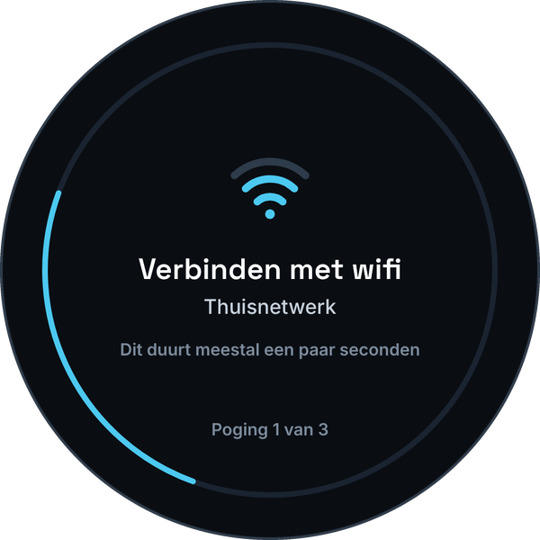 Verbinden met wifi</td>
<td align="center">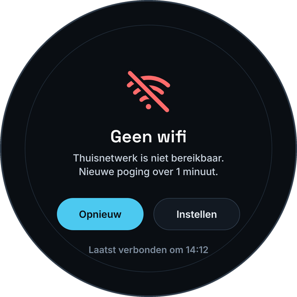 Geen wifi</td>
</tr>
<tr>
<td align="center">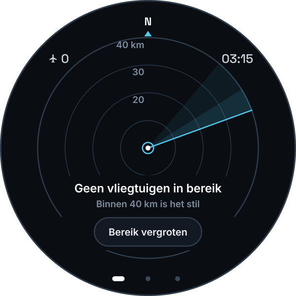 Geen vliegtuigen in bereik</td>
<td align="center">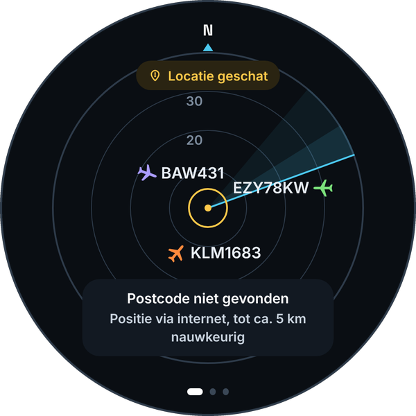 Locatie geschat</td>
<td></td>
</tr>
</table>

## Instellen via je telefoon

Bij de eerste keer opstarten kies je op je telefoon het wifi-netwerk, vul je het wachtwoord in en geef je je postcode en een profielnaam op.

<table>
<tr>
<td align="center">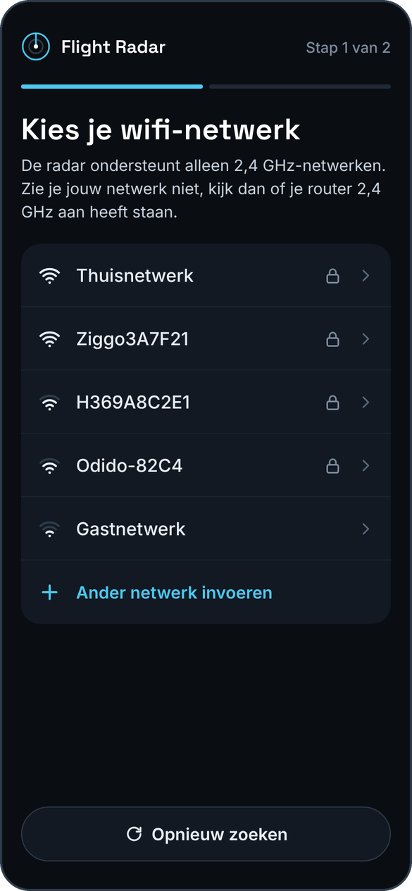 1. Wifi kiezen</td>
<td align="center">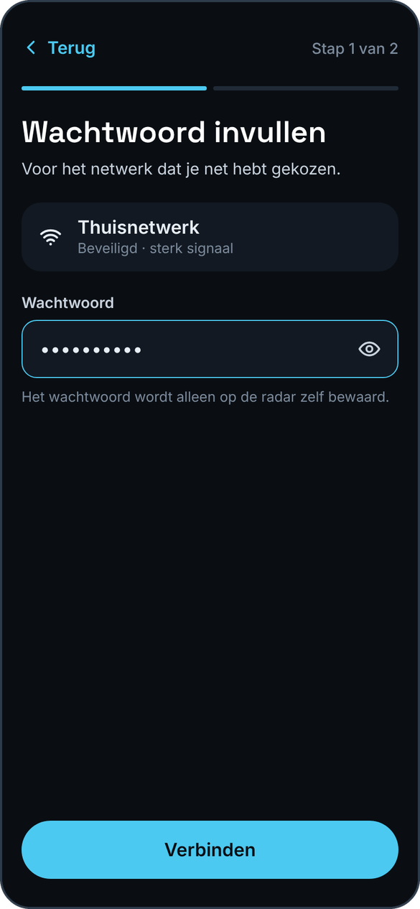 2. Wachtwoord</td>
<td align="center">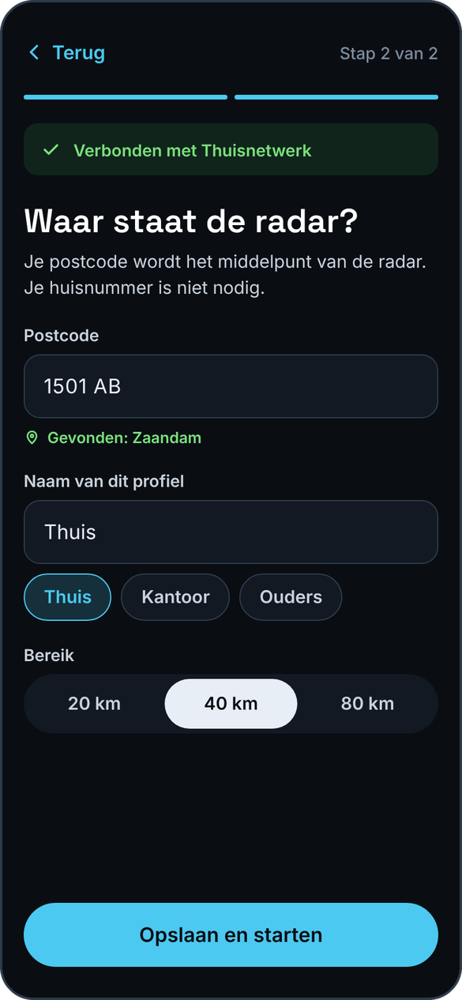 3. Postcode en naam</td>
<td align="center">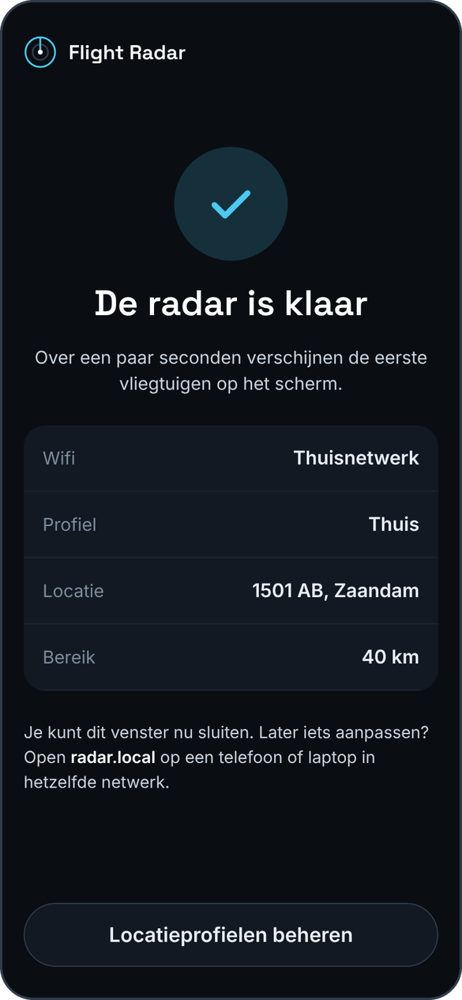 4. Klaar</td>
</tr>
</table>

## Locatieprofielen

Staat de radar soms op een andere plek? Dan maak je meerdere profielen aan, bijvoorbeeld Thuis en Kantoor.

<table>
<tr>
<td align="center">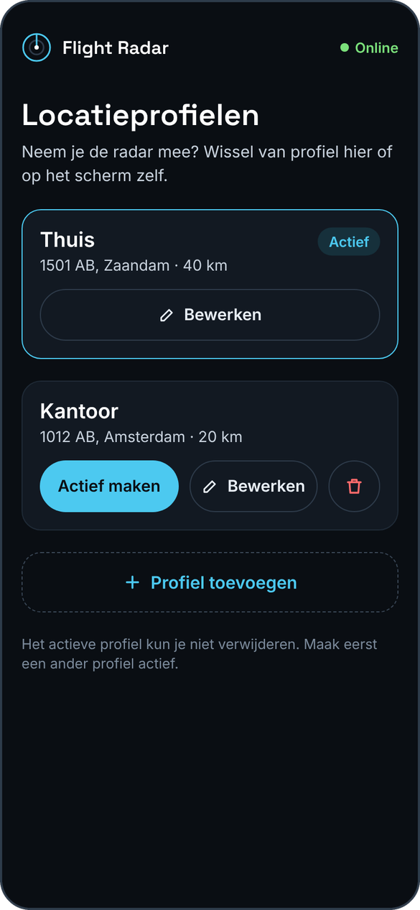 Overzicht</td>
<td align="center">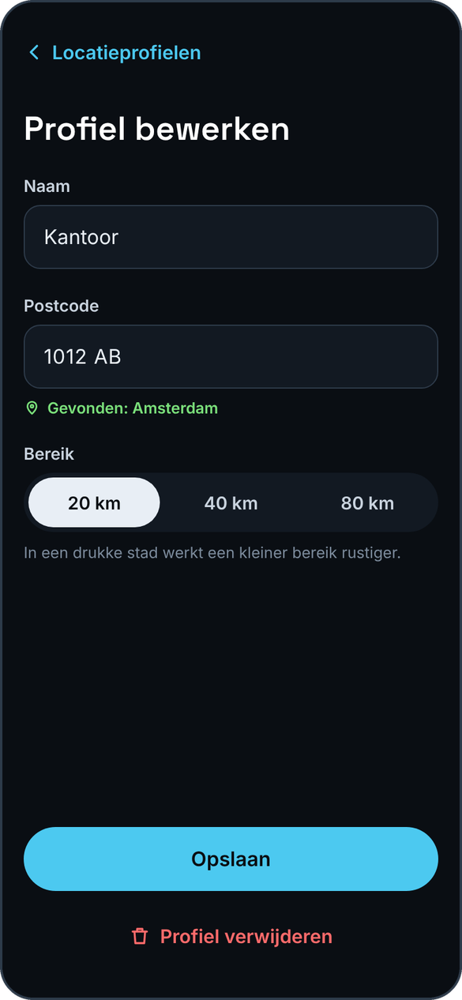 Bewerken</td>
<td align="center">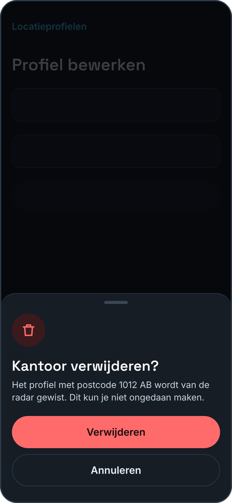 Verwijderen</td>
</tr>
</table>
